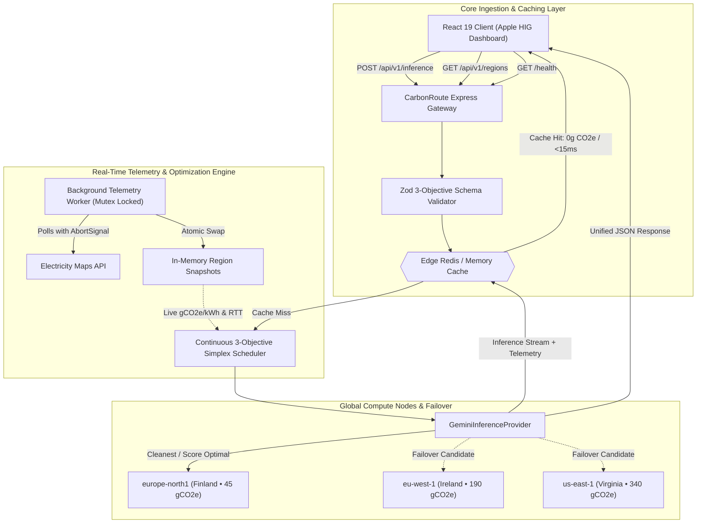

# CarbonRoute API 🌱
> **Sustainable, SLA-Aware Generative AI Inference Routing Proxy & Telemetry Engine**

[](https://carbon-route-alpha.vercel.app)
[](https://carbonroute-ipqv.onrender.com)
[](https://github.com/dheerajeshwar32/CarbonRoute)
[](https://github.com/dheerajeshwar32/carbonroute-api)

[]()
[]()
[]()
[]()
[]()
[]()

---

## 🌟 Overview

Large Language Model (LLM) compute carries substantial, geographically variable carbon intensity. Running an identical inference prompt in a fossil-fuel-reliant region emits up to **10× more $\text{CO}_2\text{e}$** than executing in a renewable-surplus region (e.g. Nordic hydro/wind vs. fossil-heavy thermal grids). Yet, traditional API gateways route purely on network latency or token pricing.

**CarbonRoute API** is an enterprise-hardened green compute gateway. It intercepts LLM requests, evaluates multi-objective Service Level Agreements (carbon intensity, token cost, and latency thresholds), checks distributed zero-emission memory caches, and dynamically routes requests to the cleanest operational cloud region in real-time.

* 🌐 **Live Web Application**: [https://carbon-route-alpha.vercel.app](https://carbon-route-alpha.vercel.app)
* 📡 **Live Gateway Endpoint**: [https://carbonroute-ipqv.onrender.com](https://carbonroute-ipqv.onrender.com)
* 📋 **OpenAPI 3.1 Contract**: [https://carbonroute-ipqv.onrender.com/api/v1/openapi.json](https://carbonroute-ipqv.onrender.com/api/v1/openapi.json)
* 💻 **Frontend Client Repo**: [dheerajeshwar32/CarbonRoute](https://github.com/dheerajeshwar32/CarbonRoute)

---

## 🧠 System Architecture



---

## 🔬 Mathematical Routing Objective

The scheduler executes constrained multi-objective optimization over all available global cloud regions $\mathcal{R}$:

$$\text{Optimal Region } r^* = \arg\min_{r \in \mathcal{R}_{\text{eligible}}} \left[ \hat{w}_{\text{carbon}} \cdot \hat{C}_r + \hat{w}_{\text{cost}} \cdot \hat{P}_r + \hat{w}_{\text{latency}} \cdot \hat{L}_r \right]$$

### 1. Hard SLA Constraint Filter
Regions violating the client's strict latency deadline are excluded from candidate ranking:
$$\mathcal{R}_{\text{eligible}} = \{ r \in \mathcal{R} \mid L_r \le \text{SLA}_{\max} \}$$

If $\mathcal{R}_{\text{eligible}} = \emptyset$, the gateway halts with an HTTP 422 `sla_unsatisfiable` envelope containing actionable relaxation hints.

### 2. Simplex Priority Weight Normalization
Developer-provided priority weights are normalized across the simplex:
$$\hat{w}_i = \frac{w_i}{\sum_{k \in \{\text{carbon, cost, latency}\}} w_k}, \quad \text{guaranteeing} \quad \sum \hat{w} = 1.0$$

### 3. Continuous Dynamic Normalization & Reference Ceilings
When $|\mathcal{R}_{\text{eligible}}| > 1$:
$$\hat{C}_r = \frac{C_r - C_{\min}}{C_{\max} - C_{\min}}, \quad \hat{P}_r = \frac{P_r - P_{\min}}{P_{\max} - P_{\min}}, \quad \hat{L}_r = \frac{L_r - L_{\min}}{L_{\max} - L_{\min}}$$

When $|\mathcal{R}_{\text{eligible}}| = 1$ or variance across a dimension is zero ($X_{\max} = X_{\min}$), metrics are scored against intrinsic physical reference ceilings to prevent degenerate `0.0000` evaluations:
$$\hat{C}_r = \min\left(1, \frac{C_r}{\text{MAX\_REF\_CARBON}}\right) \quad (\text{800 gCO}_2\text{e/kWh})$$
$$\hat{P}_r = \min\left(1, \frac{P_r}{\text{MAX\_REF\_COST}}\right) \quad (\$0.005 / \text{1k tokens})$$
$$\hat{L}_r = \min\left(1, \frac{L_r}{\text{SLA}_{\max}}\right)$$

All scores and metrics are rounded to 4 decimal places (`0.0001`), eliminating IEEE 754 floating-point jitter.

---

## 🔌 API Reference & Unified Envelope

All responses adhere to a unified, backward-compatible envelope:
```typescript
interface ApiResponse<T> {
  success: boolean;
  status: 'success' | 'error';
  meta: {
    request_id: string;
    timestamp: string;
    version: 'v1';
  };
  data?: T;
  error?: {
    code: string;
    message: string;
    details?: unknown;
  };
}
```

### 1. `POST /api/v1/inference`
Executes an inference request with custom SLA priorities.

#### cURL Request:
```bash
curl -X POST https://carbonroute-ipqv.onrender.com/api/v1/inference \
  -H "Content-Type: application/json" \
  -d '{
    "prompt": "Explain Byzantine Fault Tolerance in two sentences.",
    "model": "gemini-3.8-flash",
    "sla": {
      "max_latency_ms": 200,
      "carbon_priority_weight": 0.8,
      "cost_priority_weight": 0.1,
      "latency_priority_weight": 0.1
    }
  }'
```

#### Response (Cache Miss — Dispatched to Green Region):
```json
{
  "success": true,
  "status": "success",
  "meta": {
    "request_id": "7f09322e-a5e2-4521-b3fa-094ec235288a",
    "timestamp": "2026-11-11T10:00:00.000Z",
    "version": "v1"
  },
  "request_id": "7f09322e-a5e2-4521-b3fa-094ec235288a",
  "cache_hit": false,
  "execution_mode": "simulated",
  "model": "gemini-3.8-flash",
  "routed_to": "europe-north1",
  "location": "Finland",
  "telemetry": {
    "latency_ms": 142,
    "network_rtt_ms": 155,
    "latency_source": "measured",
    "cost_per_1k_tokens": 0.0004,
    "live_carbon_intensity": 45,
    "carbon_intensity": 45,
    "carbon_source": "live",
    "carbon_updated_at": "2026-11-11T09:55:00.000Z"
  },
  "impact": {
    "baseline_region": "ap-south-1",
    "baseline_location": "Mumbai",
    "baseline_carbon_intensity": 620,
    "carbon_saved_pct": 92.7,
    "estimated_emissions_g": 0.0108,
    "estimated_emissions_avoided_g": 0.138,
    "energy_per_request_wh": 0.24
  },
  "routing": {
    "policy": {
      "max_latency_ms": 200,
      "carbon_weight": 0.8,
      "cost_weight": 0.1,
      "latency_weight": 0.1
    },
    "baseline_region": "ap-south-1",
    "candidates": [
      {
        "id": "europe-north1",
        "location": "Finland",
        "latency_ms": 155,
        "carbon_intensity": 45,
        "score": 0.0892,
        "rank": 1,
        "status": "selected"
      },
      {
        "id": "us-east-1",
        "location": "N. Virginia",
        "latency_ms": 175,
        "carbon_intensity": 340,
        "score": 0.4851,
        "rank": 2,
        "status": "eligible"
      }
    ],
    "failover": []
  },
  "usage": {
    "prompt_tokens": 16,
    "output_tokens": 48
  },
  "data": "Byzantine Fault Tolerance is the dependability of a fault-tolerant computer system where components may fail and there is imperfect information on whether a component has failed. It guarantees consensus even if rogue nodes send contradictory messages."
}
```

#### Response (Cache Hit — Zero Emission):
```json
{
  "success": true,
  "status": "success",
  "meta": {
    "request_id": "812b1d09-b6b8-4c6e-8ee5-1b702ec13745",
    "timestamp": "2026-11-11T10:01:12.000Z",
    "version": "v1"
  },
  "request_id": "812b1d09-b6b8-4c6e-8ee5-1b702ec13745",
  "cache_hit": true,
  "execution_mode": "cache",
  "routed_to": "cache",
  "location": "Edge cache (Redis)",
  "telemetry": {
    "latency_ms": 8,
    "network_rtt_ms": 0,
    "cost_per_1k_tokens": 0,
    "live_carbon_intensity": 0,
    "carbon_intensity": 0,
    "carbon_source": "live"
  },
  "impact": {
    "carbon_saved_pct": 100,
    "estimated_emissions_g": 0,
    "estimated_emissions_avoided_g": 0.1488,
    "energy_per_request_wh": 0.24
  },
  "data": "Byzantine Fault Tolerance is the dependability of a fault-tolerant computer system..."
}
```

### 2. `GET /api/v1/regions`
Returns real-time telemetry across all 5 cloud data centers.
```bash
curl https://carbonroute-ipqv.onrender.com/api/v1/regions
```

### 3. `GET /health`
Returns system uptime, cache status, execution mode, and background polling worker telemetry.
```bash
curl https://carbonroute-ipqv.onrender.com/health
```

### 4. `GET /api/v1/openapi.json`
Returns the machine-readable OpenAPI 3.1.0 document.

---

## ⚙️ Environment Configuration

| Variable | Type | Default | Description |
| :--- | :--- | :--- | :--- |
| `PORT` | `number` | `3000` | Port for the Express gateway |
| `NODE_ENV` | `string` | `development` | Environment (`development`, `production`, `test`) |
| `GEMINI_API_KEY` | `string` | *Optional* | Google Gemini API Key |
| `GOOGLE_CLOUD_PROJECT` | `string` | *Optional* | GCP project for Vertex AI regional execution |
| `INFERENCE_MODE` | `string` | `auto` | Execution mode (`auto`, `regional`, `global`) |
| `REDIS_URL` | `string` | *Optional* | Upstash / Redis instance URL |
| `ELECTRICITY_MAPS_API_KEY` | `string` | *Optional* | Electricity Maps v3 API Token |
| `CORS_ORIGINS` | `string` | *Local + Vercel* | Comma-separated allowed HTTP origins |
| `RATE_LIMIT_MAX` | `number` | `20` | Max requests per minute per IP |

---

## 🛠️ Local Development & Testing

```bash
# 1. Clone repository
git clone https://github.com/dheerajeshwar32/carbonroute-api.git
cd carbonroute-api

# 2. Install dependencies
npm ci

# 3. Run automated test suite (20 unit & integration tests)
npm test

# 4. Compile TypeScript
npm run build

# 5. Start development server with hot-reload
npm run dev
```

---

## 👤 Author

* **Nagula Dheeraj Eshwar Prudhvi**  
* GitHub: [@dheerajeshwar32](https://github.com/dheerajeshwar32)  
* Live Dashboard: [https://carbon-route-alpha.vercel.app](https://carbon-route-alpha.vercel.app)
