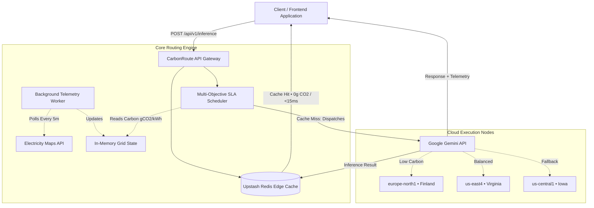

# CarbonRoute 🌱
> **Sustainable, SLA-Aware Generative AI Inference Routing Proxy & Telemetry Engine**

[](https://carbon-route-alpha.vercel.app)
[](https://github.com/dheerajeshwar32/carbonroute-api)
[](https://github.com/dheerajeshwar32/CarbonRoute)

[]()
[]()
[]()
[]()

> 🌐 **Live Web Application**: [https://carbon-route-alpha.vercel.app](https://carbon-route-alpha.vercel.app)

---

## 🌟 Overview

Large Language Model (LLM) inference carries substantial, geographically variable carbon emissions. Running compute in fossil-fuel-heavy regions produces up to **10× higher carbon emissions** than in renewable-powered regions, yet conventional API gateways route solely on raw ping latency or token price.

**CarbonRoute** is a green-computing inference proxy that dynamically routes generative AI requests to the cleanest global cloud compute region in real-time. By continuously ingesting regional power grid telemetry from the **Electricity Maps API** and evaluating multi-objective Service Level Agreement (SLA) constraints (latency bounds, cost, and carbon priority), CarbonRoute minimizes the environmental footprint of LLM inference while guaranteeing strict sub-200ms latency SLAs.

---

## 🧠 System Architecture



---

## 🔬 Mathematical Routing Objective

The routing engine solves a constrained multi-objective optimization problem for every inference call:

$$\text{Optimal Region } r^* = \arg\min_{r \in \mathcal{R}_{\text{valid}}} \left[ w_{\text{carbon}} \cdot \hat{C}_r + w_{\text{latency}} \cdot \hat{L}_r + w_{\text{cost}} \cdot \hat{P}_r \right]$$

### Constraints:
1. **Hard Latency SLA**: $L_r \le \text{SLA}_{\max}$ (default: $< 200\text{ms}$)
2. **Normalized Weights**: $w_{\text{carbon}} + w_{\text{latency}} + w_{\text{cost}} = 1.0$
3. **Normalized Metrics**: $\hat{C}_r, \hat{L}_r, \hat{P}_r \in [0, 1]$

When regional grid intensity spikes (e.g., wind generation drops or peak fossil demand rises), the scheduler dynamically steers subsequent traffic to regions with surplus renewable generation.

---

## ✨ Key Features

- 🌱 **Real-Time Grid Telemetry**:
  - Asynchronous background worker streams live carbon emissions data ($\text{gCO}_2\text{eq/kWh}$) across global cloud data centers.
- ⚡ **Zero-Emission Edge Caching (Upstash Redis)**:
  - Redundant or repeated prompts are intercepted and served directly from distributed Redis memory caches in $<15\text{ms}$, resulting in **0 gCO2** emissions and zero token cost.
- 🎯 **SLA-Constrained Dispatcher**:
  - Automatically balances developer-defined weight sliders for Carbon vs Cost vs Latency.
- 🤖 **Google Gemini API Integration**:
  - Seamlessly executes prompt generation via modern Gemini models, returning structured execution telemetry with every response.
- 📊 **Live Telemetry Dashboard**:
  - Real-time client interface visualizing cumulative carbon grams saved, routing decisions, and latency distributions.

---

## 🔌 API Reference

### `POST /api/v1/inference`

Routes a generative AI prompt according to custom SLA parameters.

#### Request Headers
```http
Content-Type: application/json
```

#### Request Payload
```json
{
  "prompt": "Explain zero-knowledge proofs in two sentences.",
  "model": "gemini-1.5-flash",
  "sla": {
    "max_latency_ms": 200,
    "carbon_priority_weight": 0.8,
    "cost_priority_weight": 0.2
  }
}
```

#### Response (Cache Miss — Green Cloud Routed)
```json
{
  "status": "success",
  "routed_to": "europe-north1",
  "location": "Hamina, Finland",
  "telemetry": {
    "latency_ms": 128,
    "cost_per_1k_tokens": 0.00025,
    "live_carbon_intensity": 34,
    "carbon_saved_percent": "38.2%",
    "cache_hit": false
  },
  "data": "A zero-knowledge proof allows one party to prove to another that a statement is true without revealing any information beyond the statement's validity. This enables mathematical verification while preserving complete underlying data confidentiality."
}
```

#### Response (Cache Hit — Zero Emission)
```json
{
  "status": "success",
  "routed_to": "Memory Cache (Redis Edge)",
  "location": "Local Edge Proxy",
  "telemetry": {
    "latency_ms": 11,
    "cost_per_1k_tokens": 0.0,
    "live_carbon_intensity": 0,
    "carbon_saved_percent": "100%",
    "cache_hit": true
  },
  "data": "A zero-knowledge proof allows one party to prove to another that a statement is true without revealing any information beyond the statement's validity..."
}
```

---

## 🛠️ Tech Stack & Dependencies

* **Frontend**: React 18, Vite, Tailwind CSS, Lucide Icons, Framer Motion
* **Backend Gateway**: Node.js, Express, TypeScript
* **Cache & Storage**: Upstash Redis (Serverless)
* **External Telemetry**: Electricity Maps API
* **Inference Engine**: Google Gemini API (`@google/generative-ai`)
* **Hosting**: Vercel (Frontend), Render (API Gateway)

---

## 🚀 Local Installation & Setup

### Prerequisites
- Node.js 18+
- Gemini API Key ([Google AI Studio](https://aistudio.google.com/))
- Upstash Redis Account ([Upstash Console](https://console.upstash.com/))

### 1. Clone the Repositories
```bash
# Clone the API Gateway
git clone https://github.com/dheerajeshwar32/carbonroute-api.git
cd carbonroute-api
```

### 2. Install Dependencies
```bash
npm install
```

### 3. Configure Environment Variables
Create a `.env` file in the root directory:
```env
PORT=10000
GEMINI_API_KEY=your_gemini_api_key
REDIS_URL=your_upstash_redis_url
ELECTRICITY_MAPS_API_KEY=your_optional_api_key
```

### 4. Build and Run
```bash
npm run build
npm start
```
The gateway will start on `http://localhost:10000` with the background telemetry worker polling active grid signals.

---

## 👤 Author

* **Nagula Dheeraj Eshwar Prudhvi**
* GitHub: [@dheerajeshwar32](https://github.com/dheerajeshwar32)
* Live Application: [CarbonRoute on Vercel](https://carbon-route-alpha.vercel.app)
