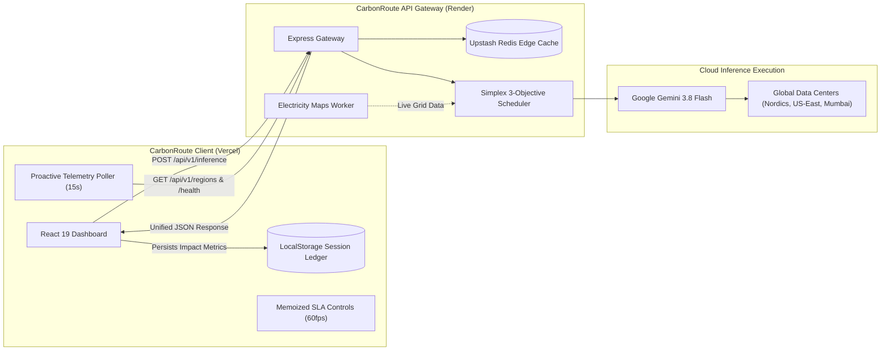

# CarbonRoute Client 🌿
> **Apple Human Interface Guidelines (macOS Sequoia) Dashboard for Sustainable AI Inference Routing**

[](https://carbon-route-alpha.vercel.app)
[](https://carbonroute-ipqv.onrender.com)
[](https://github.com/dheerajeshwar32/CarbonRoute)
[](https://github.com/dheerajeshwar32/carbonroute-api)

[]()
[]()
[]()
[-success.svg)]()

---

## 🌟 Overview

**CarbonRoute Client** is an Apple HIG-inspired dashboard engineered to monitor, configure, and visualize real-time green AI inference routing. Built with React 19 and Vite, it interfaces with the [CarbonRoute API Gateway](https://github.com/dheerajeshwar32/carbonroute-api) to steer generative AI workloads to the cleanest global cloud data centers based on live regional power grid carbon intensity.

* 🌐 **Live Web Application**: [https://carbon-route-alpha.vercel.app](https://carbon-route-alpha.vercel.app)
* 📡 **Backend API Gateway**: [https://carbonroute-ipqv.onrender.com](https://carbonroute-ipqv.onrender.com)
* 💻 **Backend Repository**: [dheerajeshwar32/carbonroute-api](https://github.com/dheerajeshwar32/carbonroute-api)

---

## ✨ Key Features & Apple HIG Experience

- 🪟 **Materials & Translucent Glassmorphism:**
  - Layered glass cards (`backdrop-filter: blur(24px) saturate(180%)`, specular hairline borders, soft ambient elevation `0 16px 36px -4px rgba(0, 0, 0, 0.4)`).
  - Eliminates harsh shadows and neon boxes in favor of subtle dark-slate specular surfaces.
- ⚡ **Zero-Jitter Optical Typography:**
  - Enforces `font-variant-numeric: tabular-nums` across all telemetry counters, live latencies, carbon grams, and SLA sliders so numbers never jitter horizontally during streaming updates.
- 📊 **Persistent Cumulative Session Carbon Ledger:**
  - Backed by `localStorage`, the ledger aggregates cumulative $\text{CO}_2\text{e}$ grams avoided across all prompts compared to the worst-case regional coal grid, tracks cache hit ratios, and provides a one-click **"Export Telemetry JSON"** action.
- 🎯 **3-Objective SLA Controls & Apple Segmented Presets:**
  - One-click presets: **Eco Max** (85% Carbon / 10% Cost / 5% Latency), **Balanced** (50% / 35% / 15%), and **Low Latency** (15% / 15% / 70%).
  - Decoupled slider and input states guaranteeing 60fps interaction during scrubbing.
- 🛑 **In-Flight Cancellation & True Error Surfacing:**
  - Seamless `AbortController` integration with an active "Cancel" button during calculation.
  - Replaces fragile string-matching errors with formal HTTP status checking and structured alert banners for `422 sla_unsatisfiable` and `400 invalid_request` issues.
- 🌐 **Live Global Grid Telemetry Drawer:**
  - Proactively polls `GET /api/v1/regions` and `GET /health` every 15 seconds so users see live data center carbon footprints and gateway connectivity immediately upon opening the app.

---

## 🧠 System Architecture



---

## 🔬 Multi-Objective Routing Formula

The frontend communicates with the gateway's continuous multi-objective scheduler:

$$\text{Optimal Region } r^* = \arg\min_{r \in \mathcal{R}_{\text{eligible}}} \left[ \hat{w}_{\text{carbon}} \cdot \hat{C}_r + \hat{w}_{\text{cost}} \cdot \hat{P}_r + \hat{w}_{\text{latency}} \cdot \hat{L}_r \right]$$

* **Hard SLA Latency Bound**: $L_r \le \text{SLA}_{\max}$
* **Simplex Weights**: $\hat{w}_{\text{carbon}} + \hat{w}_{\text{cost}} + \hat{w}_{\text{latency}} = 1.0$
* **Dynamic Carbon Scale**: Normalizes progress bars against $\max(700, \dots \text{candidates})$ to prevent clipping on high-carbon coal grids (e.g. Mumbai at 620 gCO₂e/kWh).

---

## 📦 Project Structure

```
CarbonRoute/
├── index.html                  # Apple typography & metadata headers
├── vite.config.js              # Vite 8 bundling configuration
├── package.json
├── src/
│   ├── index.css               # Design tokens, Apple SF Pro font stack, glassmorphic styles
│   ├── App.css                 # HUD components, tables, sliders, segmented controls
│   ├── main.jsx
│   ├── App.jsx                 # Main application orchestrator & abort controller
│   ├── hooks/
│   │   └── useSessionLedger.js # Persistent localStorage impact tracking & JSON export
│   ├── types/
│   │   └── contract.ts         # Strict TypeScript mirror of OpenAPI 3.1 gateway contract
│   └── components/
│       ├── Header.jsx          # Title & real-time gateway health status pill
│       ├── LogoMark.jsx        # Transparent vector glyph
│       ├── GlobalRegionsDrawer.jsx # Real-time cloud region grid status drawer
│       ├── SLAControls.jsx     # Segmented SLA presets & smooth sliders
│       ├── SessionLedgerBar.jsx# Cumulative carbon avoided summary & JSON exporter
│       ├── TelemetryStats.jsx  # Hero metrics with dynamic carbon gauge
│       ├── CandidatesTable.jsx # Multi-objective evaluation matrix
│       ├── AlertBanner.jsx     # Inline alert for SLA & API error diagnostics
│       ├── CopyRequestIdBadge.jsx # One-click trace ID copy micro-interaction
│       └── SkeletonLoader.jsx  # Spring-animated shimmer placeholder
```

---

## 🛠️ Local Development & Build

```bash
# 1. Clone repository
git clone https://github.com/dheerajeshwar32/CarbonRoute.git
cd CarbonRoute

# 2. Install dependencies
npm ci

# 3. Start local development server
npm run dev

# 4. Compile production build
npm run build
```

---

## 👤 Author

* **Nagula Dheeraj Eshwar Prudhvi**  
* GitHub: [@dheerajeshwar32](https://github.com/dheerajeshwar32)  
* Live Dashboard: [https://carbon-route-alpha.vercel.app](https://carbon-route-alpha.vercel.app)
